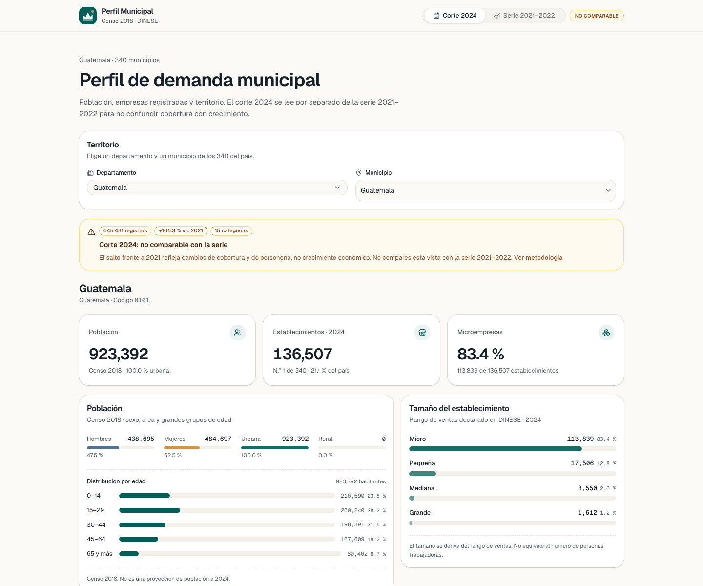

# Perfil de demanda municipal y actividad económica

Aplicación territorial que combina el **Censo 2018** con el **Directorio Nacional
Estadístico de Empresas (DINESE) 2021, 2022 y 2024** para los **340 municipios**
de Guatemala. Permite leer población, estructura de edad, establecimientos
registrados por sección CIIU, tamaño, personería jurídica y lugares poblados,
sin confundir cambios de cobertura con crecimiento económico.

> **English summary.** A Next.js + shadcn/ui territorial profile for all 340
> Guatemalan municipalities, joining Census 2018 with DINESE 2021/2022/2024.
> The 2024 cross-section is deliberately separated from the 2021–2022 series
> because coverage and legal-status coding changed. Only aggregated counts are
> published: no firm IDs, no employment, no microdata.



---

## 1. Problema y usuarios

Las bases del INE permiten responder preguntas muy concretas de territorio,
pero mezclar años, coberturas y clasificaciones produce conclusiones falsas.
Entre 2021 y 2024 DINESE pasó de **312,923 a 645,431 registros (+106.3 %)** y la
personería jurídica se recodificó de **30/29 categorías a 15**. Ese salto no es
crecimiento económico: es, al menos en parte, un cambio de cobertura y captación.

La ficha está dirigida a:

- **Equipos municipales y planificadores locales** que necesitan una lectura
  rápida de población, actividades registradas y lugares poblados.
- **Analistas territoriales y emprendedores** que comparan municipios y quieren
  entender la composición económica sin acceder a microdatos.
- **Periodistas, academia y sociedad civil** que requieren cifras trazables,
  con fuente, fecha y licencia explícitas.

## 2. Qué hace la aplicación

- Selector de **departamento** y **municipio** para los 340 municipios
  normalizados (22 departamentos).
- **Salto temporal** entre dos vistas mutuamente excluyentes:
  - **2024 Snapshot (DINESE 2024 + Census 2018)**: corte transversal.
  - **2021–2022 Series (DINESE 2021–2022 + Census 2018)**: serie corta.
- Aviso visible de cobertura y recodificación al cambiar de vista, con cifras
  en vivo y una nota de no comparabilidad.
- Resumen de población, establecimientos y microempresas.
- Población por sexo, área urbana/rural y cinco grandes grupos de edad; el
  detalle completo de 21 quinquenios permanece en los datos.
- Barras por **sección CIIU** (8 principales, con las 21 expandibles),
  **tamaño** (Micro, Pequeña, Mediana, Grande) y **personería jurídica**
  (listas completas en un diálogo).
- Posición nacional y participación del municipio en el total de
  establecimientos del año.
- **Mapa SVG local** de lugares poblados (sin teselas externas) y tabla
  filtrable con coordenadas, estado y motivo de exclusión.
- Diálogo de **fuentes y metodología** con URL exacta, fecha UTC, SHA-256 y
  licencia CKAN de cada archivo.
- Funciona sin llaves, sin servicios en la nube y sin conexión una vez
  descargados y procesados los datos.

## 3. Reglas de rigor aplicadas

| Regla | Implementación |
| --- | --- |
| 340/340 municipios | Nomenclador construido desde el Cuadro A1.2 del Censo 2018; código canónico de 4 dígitos (`depto` + `municipio`). |
| Cruce DINESE–Censo | Normalización de nombres (acentos, mayúsculas, espacios y puntuación) y verificación de que cada uno de los 340 pares de cada año mapea a un municipio. |
| Separación 2024 / 2021–2022 | `snapshot_2024` y `series_2021_2022` son estructuras distintas en la salida; no se calculan variaciones 2021→2024. |
| Sin identificadores de empresa | No se publica la columna `CÓDIGO` de DINESE ni ningún identificador estable; solo conteos agregados. |
| Sin empleo inventado | DINESE no contiene empleo. No se estima ni se imputa. El “tamaño” es rango de ventas, no personas trabajadoras. |
| Personería sin homologar | Se muestran las etiquetas oficiales de cada año; no se fuerza equivalencia entre 2021, 2022 y 2024. |
| Privacidad de lugares | Se excluyen del mapa los 301 lugares con sufijo `999` y los 313 sin coordenadas (unión: 313). No se infieren coordenadas. |
| Secreto estadístico | Solo agregados municipio × sección / tamaño / personería. Sin microdatos, nombres de empresas ni personas (Decreto-Ley 3-85). |
| Reproducibilidad | Cada archivo se registra con URL, fecha UTC y SHA-256; el build falla si un archivo local cambió respecto al manifiesto. |

### Cifras clave verificadas

- Población censada 2018: **14,901,286**.
- DINESE 2021: **312,923** registros; 2022: **313,272**; 2024: **645,431**.
- Variación 2021→2024: **+106.3 %** (no interpretable como crecimiento).
- Variación 2021→2022: **+0.1 %** (serie corta comparable).
- Personería: **30** categorías en 2021, **29** en 2022, **15** en 2024.
- CIIU: **21** secciones en los tres años.
- Lugares poblados: **20,036**; **301** con sufijo `999`; **313** sin
  coordenadas; **19,723** puntos posibles en el mapa.
- Cobertura del cruce: **340/340** municipios en cada año DINESE.

## 4. Arquitectura y tecnologías

```text
Banco de datos INE (CKAN)
  │  httpx + caché local + SHA-256 + fecha UTC
  ▼
data/raw/*.xlsx
  │  pipeline Python (uv, pandas, openpyxl)
  │  - normaliza 340 municipios
  │  - separa snapshot 2024 / serie 2021–2022
  │  - agrega conteos y filtra lugares
  ▼
web/public/data/
  ├── meta.json              # vistas, avisos, catálogos, totales nacionales, fuentes
  ├── municipalities.json    # 22 departamentos + 340 municipios
  ├── profiles/<código>.json # ficha agregada por municipio
  └── manifest.json          # procedencia de entradas + hashes de salidas
  │  fetch estático, sin API externa
  ▼
Next.js 16 (App Router) + React 19 + TypeScript + Tailwind CSS 4
  └── shadcn/ui (base-nova) + Recharts + lucide-react
```

Decisiones técnicas:

- **Salidas estáticas JSON** en lugar de una base de datos: el conjunto es
  pequeño, auditable y se sirve sin servidor de aplicaciones ni secretos.
- **Un archivo por municipio** para que la ficha cargue rápido y el resto del
  país no viaje en el bundle inicial.
- **Mapa SVG propio**: no se usan teselas de OpenStreetMap ni servicios de
  geocodificación en tiempo de ejecución. Los puntos son centroides publicados.
- **shadcn/ui** para Select, Combobox, Tabs, Alert, Badge, Card, Table,
  Tooltip, Skeleton y Chart. Los gráficos usan el componente Chart de shadcn/ui
  sobre Recharts.

### Estructura del repositorio

```text
.
├── pyproject.toml / uv.lock       # pipeline Python reproducible
├── src/municipal_profile/
│   ├── catalog.py                 # URLs oficiales y licencias
│   ├── fetch.py                   # caché, descarga, SHA-256, procedencia
│   ├── build.py                   # agregación y salidas JSON
│   ├── schema.py                  # CIIU, edades, avisos de comparabilidad
│   └── cli.py                     # municipal-profile fetch|build|all
├── tests/                         # pytest (cruce, exclusiones, separación, fetch)
├── data/raw/                      # .xlsx en caché (ignorados por git)
├── web/                           # Next.js + shadcn/ui
│   ├── src/app/                   # layout, página, estilos
│   ├── src/components/            # tarjetas, gráficos, mapa, tabla, fuentes
│   ├── src/lib/                   # tipos, formato, hooks de datos
│   └── public/data/               # salidas generadas servidas por Next.js
├── README.md
└── LICENSE
```

## 5. Instalación y ejecución local

### Requisitos

- Python **3.12+**
- [`uv`](https://docs.astral.sh/uv/)
- Node.js **20+**
- [`pnpm`](https://pnpm.io/)

### 1) Preparar datos y generar JSON

Desde la raíz del repositorio:

```bash
uv sync
uv run municipal-profile all
```

`all` hace lo siguiente:

1. Busca los cinco `.xlsx` en `data/raw/`.
2. Si falta alguno, lo descarga desde la URL oficial del INE y lo guarda en
   caché. Registra URL, fecha UTC, tamaño y SHA-256 en
   `data/provenance.json` y en el manifiesto de salida.
3. Construye los 342 JSON agregados y el manifiesto en `web/public/data/`.

Comandos por separado:

```bash
uv run municipal-profile fetch           # solo descargar/verificar
uv run municipal-profile fetch --force   # forzar re-descarga
uv run municipal-profile build           # solo transformar
uv run municipal-profile all             # fetch + build
```

El pipeline es **offline-first**: si los archivos existen, no toca la red. Si un
archivo local no coincide con el SHA-256 registrado, `build` se detiene con un
mensaje que pide volver a descargarlo.

### 2) Levantar la aplicación

```bash
cd web
pnpm install
pnpm dev
```

Abrir <http://localhost:3000>.

Build de producción:

```bash
cd web
pnpm build
pnpm start
```

### 3) Pruebas

```bash
uv run pytest
```

Las pruebas de integración reutilizan la caché local o descargan los archivos
oficiales si todavía no existen. Cubren:

- cruce **340/340** y suma de conteos municipales contra totales nacionales;
- separación estricta entre `snapshot_2024` y `series_2021_2022`;
- exclusión de sufijo `999` y de lugares sin coordenadas de los puntos del
  mapa, conservándolos en la tabla;
- ausencia de identificadores de empresa y de campos de empleo;
- consistencia CIIU / tamaño / personería y sumas de población;
- recodificación 30/29/15 y avisos de cobertura;
- descarga de un `.xlsx` ausente con URL, fecha UTC y SHA-256;
- rechazo de una respuesta que no sea XLSX;
- hashes de todas las salidas contra `manifest.json`.

## 6. Conjuntos de datos y procedencia

Todos los archivos provienen del **banco de datos abierto del INE**
(`https://datos.ine.gob.gt`), verificado el **25 de noviembre de 2026 (UTC)**.
La descarga registrada en este repositorio se hizo el **25 de noviembre de 2026,
04:48–04:49 UTC** (24 de noviembre en hora local de Guatemala).

| Conjunto | Archivo | URL oficial | Descarga UTC | SHA-256 (inicio) | Licencia |
| --- | --- | --- | --- | --- | --- |
| Censo 2018 — Cuadro A1 | `censo-a1.xlsx` | [enlace](https://datos.ine.gob.gt/dataset/78019333-d80b-45e8-b694-fb3b8d65e19e/resource/4b9c7220-ca0c-41a9-a121-348f533b070e/download/cuadro-a1-poblacion-total-censada-por-sexo-grupos-quinquenales-de-edad-y-area.xlsx) | 2026-11-25T04:48:46Z | `b4dfbc6a0373373e…` | CC BY (CKAN) |
| Censo 2018 — Lugares poblados | `lugares-poblados.xlsx` | [enlace](https://datos.ine.gob.gt/dataset/78019333-d80b-45e8-b694-fb3b8d65e19e/resource/053dfa99-b3f9-4b1f-a99f-fc933ef00da4/download/centroides-de-lugares-poblados-de-la-republica-de-guatemala.-censo-2018.xlsx) | 2026-11-25T04:48:47Z | `b8ea8fea33e6d606…` | CC BY (CKAN) |
| DINESE 2021 | `dinese-2021.xlsx` | [enlace](https://datos.ine.gob.gt/dataset/794d0a7e-6c2b-4c21-809f-f23b8936407c/resource/d785b230-1933-4fad-9223-cb0d3647ef2e/download/dinese-2021.xlsx) | 2026-11-25T04:49:04Z | `17c5f741f456b7a2…` | CC BY (CKAN) |
| DINESE 2022 | `dinese-2022.xlsx` | [enlace](https://datos.ine.gob.gt/dataset/794d0a7e-6c2b-4c21-809f-f23b8936407c/resource/46d58dea-4529-4486-a5cd-cfc648401b19/download/dinese-2022.xlsx) | 2026-11-25T04:49:14Z | `1c5ddffc99e7b990…` | CC BY (CKAN) |
| DINESE 2024 | `dinese-2024.xlsx` | [enlace](https://datos.ine.gob.gt/dataset/794d0a7e-6c2b-4c21-809f-f23b8936407c/resource/d6836e3d-c7fe-457b-adbf-26ab462dfb56/download/dinese-2024.xlsx) | 2026-11-25T04:49:29Z | `7da9cbee0e64004d…` | CC BY (CKAN) |

Hashes completos, tamaños, fechas de verificación y estado de licencia:
[`web/public/data/manifest.json`](web/public/data/manifest.json) y
[`data/provenance.json`](data/provenance.json).

**Licencia de los datos:** Creative Commons Attribution (CC BY), según el
paquete CKAN del INE (`license_id: cc-by`, `license_url:
http://www.opendefinition.org/licenses/cc-by`). Fuente obligatoria: **Instituto
Nacional de Estadística (INE), Guatemala**.

### Diccionario mínimo

- **Establecimiento:** registro incluido en DINESE para un municipio y año. No
  implica que esté operando ni que tenga asalariados.
- **Tamaño:** rango de ventas declarado en DINESE (Micro, Pequeña, Mediana,
  Grande). **No es número de empleados.**
- **Personería:** tipo de personería tal como lo codifica DINESE en cada año.
- **Sección CIIU:** gran división de actividad económica (21 secciones,
  CIIU Rev. 4).
- **Lugar poblado:** unidad geográfica del Censo 2018; el punto es su centroide.

## 7. Salidas generadas

| Archivo | Contenido |
| --- | --- |
| `meta.json` | Vistas, avisos, catálogo CIIU, categorías de personería, totales nacionales, cobertura, fuentes, definiciones y límites. |
| `municipalities.json` | 22 departamentos y 340 municipios con población, establecimientos por año, posición nacional y participación. |
| `profiles/<código>.json` | Población, `snapshot_2024`, `series_2021_2022` y lugares poblados de un municipio. |
| `manifest.json` | Separación de vistas, reglas de privacidad, hashes de entradas y de las 342 salidas. |

El código de municipio es de **4 dígitos**: dos del departamento + dos del
municipio (p. ej. `0101` = Guatemala; `0705` = Nahualá).

## 8. Privacidad, ética y secreto estadístico

- No se publican identificadores de establecimientos, nombres de empresas,
  direcciones ni personas.
- No se publican cifras de empleo, ventas ni activos. DINESE no las contiene.
- Las salidas son conteos agregados a nivel municipal y por dimensión; no
  permiten reconstruir un establecimiento individual.
- Los lugares poblados son unidades censales públicas; sus centroides no son
  direcciones de empresas.
- Los registros con sufijo `999` (`Otros lugares poblados`) y los que no tienen
  coordenadas se excluyen de la capa de puntos. Se conservan en la tabla con su
  motivo para que la regla sea auditable.
- La aplicación no usa servicios externos en tiempo de ejecución, no envía
  datos a terceros y no requiere credenciales.
- Marco aplicado: **Decreto-Ley 3-85**, Ley Orgánica del INE, y buenas prácticas
  de secreto estadístico.

## 9. Limitaciones

- **Desfase temporal:** la población es de 2018; DINESE es de 2021, 2022 y
  2024. No se proyecta población ni se calculan tasas por habitante para 2024.
- **Cobertura:** el salto de 312,923 a 645,431 registros entre 2021 y 2024 no
  se interpreta como crecimiento. La app no calcula variaciones entre vistas.
- **Serie corta:** 2021–2022 solo se compara entre esos dos años. Las etiquetas
  de personería pueden variar entre ambos y no se homologan.
- **Sin empleo:** no hay número de personas trabajadoras, ventas ni producción.
  El “tamaño” es un rango de ventas.
- **Centroides:** son puntos publicados del Censo 2018, no límites municipales
  ni ubicaciones exactas de establecimientos. El mapa es una referencia, no un
  mapa catastral.
- **Cobertura geográfica:** 313 lugares sin coordenadas o con sufijo `999` no se
  dibujan; no se imputan posiciones.
- **Datos estáticos:** si el INE actualiza un archivo, hay que ejecutar
  `uv run municipal-profile all --force` para refrescar caché, hashes y JSON.
- **Alcance:** no sustituye el análisis de microdatos ni una evaluación de
  demanda con encuestas propias.

## 10. Pruebas y criterios de aceptación

| Criterio del PRD | Dónde se cumple | Prueba |
| --- | --- | --- |
| Descarga de `.xlsx` ausentes con URL, UTC y SHA-256 | `fetch.py` + `data/provenance.json` | `tests/test_fetch.py` |
| Salto temporal con aviso de cobertura y recodificación | `TimeJump`, `NoticeBanner`, `meta.views` | `test_2024_snapshot_is_separated_from_2021_2022_series`, `test_legal_status_recoding_is_explicit` |
| 340 municipios seleccionables y métricas por CIIU, tamaño y personería | `TerritoryPicker`, tarjetas y gráficos | `test_crosswalk_has_all_340_municipalities`, `test_ciiu_size_and_legal_totals_are_consistent` |
| Sin identificadores de empresa ni empleo inventado | `build.py` (solo agregados) | `test_dinese_metrics_are_aggregates_without_firm_ids_or_employment` |
| Exclusión de `999` y sin coordenadas de los puntos | `build_places` + mapa SVG | `test_places_suffix_999_and_missing_coordinates_are_not_map_points` |
| Instalación local con `uv` y `pnpm` | este README | ejecución manual |

## 11. Uso de inteligencia artificial (declaración explícita)

El desarrollo contó con asistencia de **IA generativa**: el agente de código
**opencode** con el modelo **DeepSeek V4.1 Flash** se utilizó para el andamiaje
del proyecto, la implementación del pipeline y de la interfaz, la revisión de
código, la redacción de documentación y la generación de pruebas.

- La IA **no** se usa en tiempo de ejecución de la aplicación.
- La IA **no** tuvo acceso a microdatos ni a datos personales; solo a los
  archivos públicos del INE y a las salidas agregadas.
- Las decisiones de interpretación (cobertura, recodificación, exclusiones,
  secreto estadístico) se verificaron contra los archivos y metadatos del INE y
  están documentadas en este README.
- El equipo deja constancia de que puede explicar y defender el código
  presentado, conforme a las bases del Datatón.

No se utilizaron servicios de pago ni se requieren claves para ejecutar la
herramienta.

## 12. Licencias y créditos

- **Código de la aplicación:** MIT (ver [`LICENSE`](LICENSE)).
- **Datos:** © Instituto Nacional de Estadística (INE), Guatemala. Licencia
  CC BY según CKAN. Cita sugerida: *INE. Censo 2018 y DINESE 2021–2024. Banco de
  datos abierto, https://datos.ine.gob.gt*.
- **Componentes de terceros:** Next.js (MIT), React (MIT), Tailwind CSS (MIT),
  shadcn/ui (MIT), Base UI (MIT), Recharts (MIT), cmdk (MIT), lucide-react
  (ISC), pandas (BSD-3-Clause), openpyxl (MIT), httpx (BSD-3-Clause), pytest
  (MIT). Cada componente conserva su licencia original.

Hecho para el **Datatón INE 2026**.
