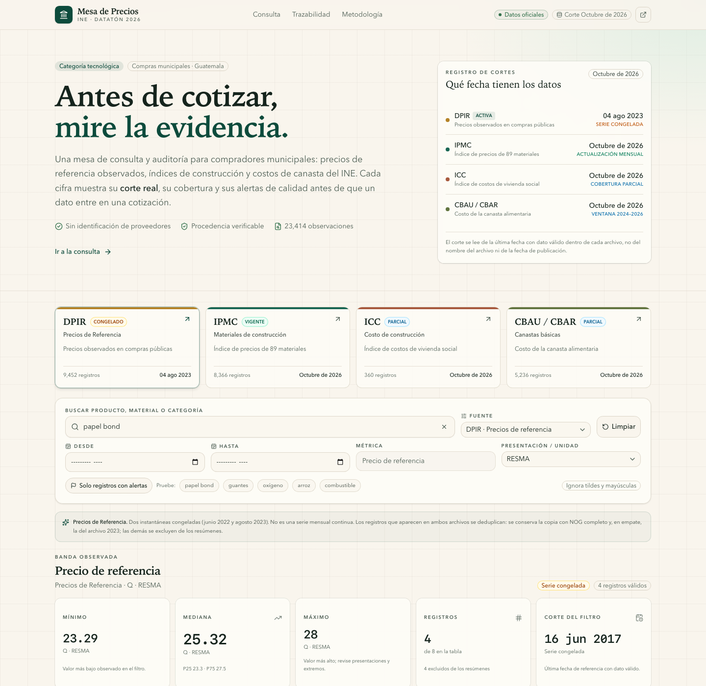

# Mesa de Precios — compras municipales con datos del INE

Aplicación local de consulta y auditoría **pre-cotización** para equipos de compras
municipales y revisores administrativos en Guatemala. Reúne los Precios de Referencia
(DPIR), el Índice de Precios de Materiales de Construcción (IPMC), el Índice de Costos
de Construcción (ICC) y las Canastas Básicas Alimentarias (CBAU y CBAR) del Instituto
Nacional de Estadística (INE), y muestra cada cifra con su **corte real**, su cobertura,
su licencia y sus alertas de calidad.

> **Idea central:** antes de usar un precio en una cotización o en una base de
> licitación, hay que saber de qué fecha es, qué mide y qué tan limpio está el registro.
> Mesa de Precios hace visible esa evidencia.



---

## 1. Problema y usuarios

### Problema

Los equipos municipales suelen cotizar con planillas propias, correos o precios
recordados. Cuando consultan datos del INE se encuentran con archivos que:

- no son series mensuales continuas (el DPIR son cortes congelados),
- mezclan precios en quetzales con índices (IPMC, ICC) que no son precios,
- traen fechas imposibles (`30/11/-0001`), duplicados entre archivos y precios con
  comas de miles (`4,200,000.00`),
- cambian de cobertura (ICC solo 2026 y Región I; IPMC Región I Metropolitana),
- y tienen fechas de corte que no coinciden con el nombre del archivo.

### Usuarios

| Usuario | Necesidad |
| --- | --- |
| Comprador municipal / unidad de compras | Ver una banda observada, su fecha y su unidad antes de pedir cotizaciones o preparar especificaciones. |
| Revisor administrativo / auditor | Detectar fechas inválidas, duplicados, comas de miles, registros sin NOG y series congeladas antes de confiar en un dato. |
| Analista de datos / equipo técnico | Reproducir la limpieza, verificar hashes y regenerar los artefactos sin servicios en la nube. |

---

## 2. Qué hace la aplicación

- **Búsqueda por producto, material o categoría**, sin distinguir tildes ni mayúsculas.
- **Selector de fuente** (DPIR, IPMC, ICC, CBAU/CBAR) y filtros por mes.
- **Tarjetas de banda**: mínimo, mediana, máximo, cuartiles, número de registros,
  corte real y estado (congelado, vigente o cobertura parcial).
- **Filtro de presentación/unidad**: evita comparar una resma con una libra. Si una
  búsqueda devuelve varias presentaciones, la aplicación preselecciona la más frecuente
  y permite volver a “Todas”.
- **Tabla de hallazgos** con precio/índice, fecha, presentación y badges de calidad:
  fecha inválida, sin fecha, duplicado, comas de miles, sin NOG, sin precio, sin producto.
- **Verificador de precio unitario**: compara un valor contra la banda filtrada y avisa
  si está por debajo del mínimo, dentro del rango o por encima del máximo; muestra la
  posición estimada y la diferencia contra la mediana.
- **Auditoría de calidad**: cuántos registros entran en los resúmenes, cuántos se
  excluyen y por qué; botón “Ver solo alertas”.
- **Trazabilidad por archivo**: URL oficial exacta, hora UTC de descarga, SHA-256,
  tamaño, licencia, corte efectivo y notas de cobertura.
- **Funciona sin conexión** una vez que los archivos están en `data/raw/` y los
  artefactos en `web/data/` (ambos se incluyen en el repositorio).

---

## 3. Inicio rápido

Requisitos probados: **Python 3.12**, **uv 0.13.9**, **Node.js 26**, **pnpm 12.23.0**.

```bash
# 1. Dependencias de Python y artefactos de datos
uv sync
uv run python -m procurement_prices build --offline

# 2. Aplicación web
cd web
pnpm install
pnpm dev
# Abra http://localhost:3000
```

Si el puerto 3000 está ocupado:

```bash
pnpm exec next dev -p 3188
```

Si falta algún archivo crudo o se quiere verificar la descarga oficial:

```bash
# Descarga solo lo que falte y registra URL, hora UTC y SHA-256
uv run python -m procurement_prices acquire

# Reconstruye Parquet + JSON para la web
uv run python -m procurement_prices build

# Descarga forzada de todo (nuevo manifiesto de procedencia)
uv run python -m procurement_prices all --force

# Comprueba que los archivos cacheados coinciden con su SHA-256
uv run python -m procurement_prices verify
```

Desde `web/` también se puede regenerar la data:

```bash
pnpm data   # equivale a: uv run --project .. python -m procurement_prices build
```

### Producción local

```bash
cd web
pnpm build
pnpm start
```

No se usan variables de entorno, llaves, bases de datos ni servicios en la nube.

---

## 4. Arquitectura y stack

```text
┌──────────────────────────────────────────────────────────────────────┐
│ Fuentes oficiales del INE                                            │
│ · datos.ine.gob.gt (CKAN: DPIR, CBAU/CBAR)                           │
│ · www.ine.gob.gt (IPMC histórico, ICC; uploads del sitio)            │
└───────────────────────────────┬──────────────────────────────────────┘
                                │  acquire: requests + validación de
                                │  firma ZIP/CSV + SHA-256 + hora UTC
                                ▼
┌──────────────────────────────────────────────────────────────────────┐
│ data/raw/            archivos crudos cacheados                      │
│ data/provenance/     downloads.json (URL, UTC, hash, licencia)       │
└───────────────────────────────┬──────────────────────────────────────┘
                                │  build: pandas + openpyxl
                                ▼
┌──────────────────────────────────────────────────────────────────────┐
│ Limpieza y normalización (Python, uv)                                │
│ · parse_number: 1,234.56 / 3,500.000 / 1.234,56 / Sin Dato          │
│ · parse_date: dd/mm/yyyy, ISO, serial de Excel; marca imposibles     │
│ · deduplicación DPIR 2022 vs 2023 (fuerte por NOG, débil sin NOG)    │
│ · estadísticas: min, P25, mediana, P75, max, corte                  │
│ · salidas: data/processed/records.parquet, summary.json, manifest    │
└───────────────────────────────┬──────────────────────────────────────┘
                                │  export: JSON compacto
                                ▼
┌──────────────────────────────────────────────────────────────────────┐
│ web/data/  records.json · summary.json · manifest.json · catalog     │
└───────────────────────────────┬──────────────────────────────────────┘
                                │  Next.js Route Handler / Server Component
                                ▼
┌──────────────────────────────────────────────────────────────────────┐
│ Next.js 16 + React 19 + TypeScript + Tailwind CSS 4                  │
│ shadcn/ui (Radix): Card, Select, Input, Table, Badge, Alert, Button  │
│ /api/records: filtra, calcula cuartiles, devuelve página + facetas   │
└──────────────────────────────────────────────────────────────────────┘
```

### Stack

| Capa | Tecnología |
| --- | --- |
| Ingesta y limpieza | Python 3.12, pandas, openpyxl, pyarrow, requests |
| Gestión de Python | `uv` (`pyproject.toml`, `uv.lock`) |
| Pruebas | `pytest` (23 pruebas) + `ruff` |
| Frontend | Next.js 16.4.6 (App Router), React 19.3, TypeScript 5.9 |
| UI | Tailwind CSS 4.3 + shadcn/ui (Radix UI) + lucide-react |
| Gestión de Node | `pnpm` (`package.json`, `pnpm-lock.yaml`) |
| Persistencia | Archivos locales: Parquet + JSON; sin base de datos |

### Por qué no hay una base de datos

El volumen es pequeño (~23 mil observaciones), el uso es local y la reproducibilidad
importa más que la concurrencia. Un bundle JSON versionado permite que el jurado abra
la aplicación sin descargar nada y que la auditoría compare el JSON con el Parquet y
con el manifiesto de hashes.

---

## 5. Fuentes de datos, cortes y licencias

Los archivos se descargaron el **25 de noviembre de 2026** (UTC) y se cachearon en
`data/raw/`. El manifiesto completo con hashes íntegros está en
`data/provenance/downloads.json`.

| # | Conjunto | Archivo | Corte real (último dato) | Licencia |
| --- | --- | --- | --- | --- |
| 1 | DPIR — junio 2022 | `base-de-datos-pr-actualizados-hasta-junio-2022.csv` | 21 jun 2022 | ODC-BY |
| 2 | DPIR — agosto 2023 | `precios-de-referencia-al-02102023.xlsx` | 04 ago 2023 | ODC-BY |
| 3 | Diccionario DPIR | `diccionario-pr.xlsx` | No aplica | ODC-BY |
| 4 | IPMC histórico | `HISTORICO-OCTUBRE.xlsx` | Octubre 2026 | CC-BY |
| 5 | ICC VSB 2026 | `Historico-ICC_VSB_OCTUBRE..xlsx` | Octubre 2026 | No declarada |
| 6 | CBAU per cápita | `costo-cba-percapita_u.xlsx` | Octubre 2026 | No declarada |
| 7 | CBAR per cápita | `costo-cba-percapita_r.xlsx` | Octubre 2026 | No declarada |
| 8 | CBAU grupos/productos | `historico-cbau_es_2024-2026.xlsx` | Octubre 2026 | No declarada |
| 9 | CBAR grupos/productos | `historico-cbar_es_2024-2026.xlsx` | Octubre 2026 | No declarada |

### URLs exactas y hora UTC de descarga

1. **DPIR junio 2022** — descargado `2026-11-25T04:29:43Z`
   `https://datos.ine.gob.gt/dataset/b247b9ac-e95f-4c32-acd3-fc4bdfb6185a/resource/aec255ce-11f0-4d6c-90d2-af41b1a49870/download/base-de-datos-pr-actualizados-hasta-junio-2022.csv`
2. **DPIR agosto 2023** — descargado `2026-11-25T04:29:43Z`
   `https://datos.ine.gob.gt/dataset/b247b9ac-e95f-4c32-acd3-fc4bdfb6185a/resource/d2c5d27a-a4e1-4263-9f3a-10b344884d28/download/precios-de-referencia-al-02102023.xlsx`
3. **Diccionario DPIR** — descargado `2026-11-25T04:29:45Z`
   `https://datos.ine.gob.gt/dataset/b247b9ac-e95f-4c32-acd3-fc4bdfb6185a/resource/024bd9b2-9fb0-45c8-9635-0056f81dd6b0/download/diccionario-pr.xlsx`
4. **IPMC histórico** — descargado `2026-11-25T04:29:45Z`
   `https://www.ine.gob.gt/ine/wp-content/uploads/2026/11/HISTORICO-OCTUBRE.xlsx`
5. **ICC VSB 2026** — descargado `2026-11-25T04:29:46Z`
   `https://www.ine.gob.gt/ine/wp-content/uploads/2026/11/Historico-ICC_VSB_OCTUBRE..xlsx`
6. **CBAU per cápita** — descargado `2026-11-25T04:29:47Z`
   `https://datos.ine.gob.gt/dataset/0317e7b9-9563-4a9c-800f-c74473103063/resource/6721d034-7af0-4622-ae34-be10f0f2ac89/download/costo-cba-percapita_u.xlsx`
7. **CBAR per cápita** — descargado `2026-11-25T04:29:47Z`
   `https://datos.ine.gob.gt/dataset/0317e7b9-9563-4a9c-800f-c74473103063/resource/69abf503-56da-4de5-9017-875009394843/download/costo-cba-percapita_r.xlsx`
8. **CBAU grupos/productos** — descargado `2026-11-25T04:29:48Z`
   `https://datos.ine.gob.gt/dataset/0317e7b9-9563-4a9c-800f-c74473103063/resource/595747ff-a866-4192-99fa-fc032a7795b7/download/historico-cbau_es_2024-2026.xlsx`
9. **CBAR grupos/productos** — descargado `2026-11-25T04:29:49Z`
   `https://datos.ine.gob.gt/dataset/0317e7b9-9563-4a9c-800f-c74473103063/resource/23cf94ba-25e9-457b-87fd-a5c7c1e92bcd/download/historico-cbar_es_2024-2026.xlsx`

Páginas de origen:

- DPIR: <https://datos.ine.gob.gt/dataset/precios-de-referencia>
- IPMC: <https://datos.ine.gob.gt/dataset/indice-de-precios-de-materiales-de-construccion-ipmc> y <https://www.ine.gob.gt/indice-de-materiales-de-construccion/>
- ICC: <https://www.ine.gob.gt/indice-de-costos/>
- CBAU/CBAR: <https://datos.ine.gob.gt/dataset/costos-de-la-cba-urbana-y-rural>

<details>
<summary>Hashes SHA-256 completos (también en data/provenance/downloads.json)</summary>

```text
dpir-2022       a5f4cb9ca17311acd2f3c69df1da41874c74c6d57e842d4d75815343812ebb3f
dpir-2023       e299291f5caf41706bd9c4633e5839c5e7773d31bb3d6680143ddcd822094a7d
dpir-dictionary 01afdf1f3e4373263f0368916417f2959179c572f92387e8c61c9d82a919888e
ipmc-history    744e99015d872dfaf2162044632cb6409d7bb80b8d4a5cfb3e1fd0c3b62310f6
icc-2026        197c455d96410b915aa17b9127474643978acc5199d99fc89dd53f544be63d85
cbau-percapita  2ad67b889e831c43714ed6a7e92ab62ba5c8561969c947ece636ec4714fd36f3
cbar-percapita  464e370e7bfa96d366baf1c70ab3d22a1df5d3e7af835e6f9092174d740aead5
cbau-history    69a68a251527d6e689248ed0391fd32abc4163449d84d1bcd9c03017550d3206
cbar-history    c8c06b1c946336d5908aa8a1f386f2d9c5a6b2419e66c127be5f306032fea048
```

El manifiesto conserva el hash completo de 64 caracteres. La interfaz muestra una
versión truncada y permite copiar el valor íntegro con el botón **Hash**.

</details>

### Nota sobre la descarga del sitio del INE

El sitio `www.ine.gob.gt` puede responder con una página CAPTCHA a peticiones
automatizadas. El pipeline intenta primero la ruta pública del upload
(`/ine/wp-content/...`) y valida la firma ZIP del `.xlsx` antes de aceptar la
respuesta; una página HTML nunca se guarda como si fuera un Excel. Si el sitio
bloquea la descarga en una red distinta, los archivos ya cacheados y verificados
permiten ejecutar todo el proyecto sin conexión. Cada intento fallido queda en
`attemptedUrls` del manifiesto.

### Licencias

- **DPIR**: Open Data Commons Attribution License (ODC-BY).
- **IPMC**: Creative Commons Attribution (CC-BY).
- **ICC y CBAU/CBAR**: el portal CKAN no declaraba licencia al momento de la
  descarga. La aplicación muestra “Licencia no declarada” y atribuye los datos al
  INE. Antes de redistribuir, confirme los términos con el INE.
- **Código de esta aplicación**: el repositorio incluye su propia licencia
  (`LICENSE`).

---

## 6. Reglas de limpieza y calidad

### Precios con comas

`parse_number` acepta los tres formatos presentes en los archivos:

| Texto | Valor | Interpretación |
| --- | --- | --- |
| `1,234.56` | 1234.56 | coma de miles + punto decimal |
| `4,200,000.00` | 4200000.00 | varias comas de miles |
| `3,500.000` | 3500.000 | coma de miles + punto decimal |
| `1.234,56` | 1234.56 | punto de miles + coma decimal |
| `12,50` | 12.50 | coma decimal |
| `1,234` | 1234.00 | heurística: 3 dígitos → miles |
| `0,123` | 0.123 | excepción: cero inicial → decimal |
| `Sin Dato` / `#N/A` | `null` | se marca `missing_value` |

El flag `thousands_comma` se conserva en el registro aunque el valor ya esté
convertido. No se elimina el registro de la tabla: se muestra con su badge y se
excluye solo si además es inválido o duplicado.

### Fechas

`parse_date` entiende `dd/mm/yyyy`, ISO y seriales de Excel. Una fecha como
`30/11/-0001` no se “corrige” ni se inventa: se conserva el texto original, se marca
`invalid_date` y el registro no entra en los resúmenes. Lo mismo ocurre con
`31/02/2020`.

### Duplicados

El DPIR 2023 contiene la mayor parte del DPIR 2022. El pipeline usa:

1. una **clave fuerte** `(NOG, producto, presentación, valor, fecha)`;
2. una **clave débil** sin NOG para el caso en que el archivo 2023 perdió el NOG
   pero el 2022 lo conserva.

Se conserva la copia con NOG completo y, en empate, la del archivo 2023. Dos
registros con NOG distintos **no** se colapsan: pueden ser procesos de compra
distintos. Los duplicados quedan visibles con el badge “Duplicado” y
`duplicateOf`, pero no entran en la mediana.

Resultado actual del DPIR:

- 9,452 filas crudas (4,457 del archivo 2022 + 4,995 del archivo 2023).
- 5,074 registros canónicos.
- 4,368 duplicados marcados.
- 10 registros sin precio.
- 633 precios con comas de miles.
- 3 registros del archivo 2023 sin NOG (la copia 2022 completa se conserva).

### Cálculo de la banda

- Solo entran registros con valor numérico y fecha válida y sin flag `duplicate`.
- Se calculan mínimo, P25, mediana, P75, máximo y media.
- La mediana y los cuartiles usan interpolación lineal entre valores ordenados.
- La tarjeta “Corte del filtro” usa la última fecha válida **del filtro activo**;
  no es el corte global de la fuente.
- Si el filtro mezcla presentaciones, la aplicación lo advierte y ofrece el filtro
  de presentación. La preselección automática elige la presentación más frecuente
  de la búsqueda.

---

## 7. Secreto estadístico y atribución

- No se incluyen nombres de proveedores, postores, empresas ni identificadores
  comerciales.
- Del DPIR se omiten deliberadamente `Entidad Requirente` y cualquier campo que no
  sea necesario para la lectura de precios.
- Las salidas son observaciones agregadas o de precio; no se intenta reidentificar
  personas, hogares o empresas.
- La aplicación muestra la atribución al INE y las licencias por archivo.
- Los datos se presentan como referencia pre-cotización, no como un dictamen de
  precios ni como una autorización de compra.

---

## 8. Pruebas

```bash
uv run pytest          # 23 pruebas
uv run ruff check src tests
cd web && pnpm typecheck && pnpm build
```

Cobertura de las pruebas:

- `parse_number` con comas de miles, decimales, negativos y placeholders.
- `parse_date` con `30/11/-0001`, fechas imposibles, ISO y valores faltantes.
- Detección de duplicados dentro de un archivo y entre DPIR 2022/2023.
- Recuperación de la copia con NOG cuando la copia nueva lo perdió.
- No colapsar dos NOG distintos.
- Mediana, P25, P75, mínimo y máximo con valores conocidos.
- Exclusión de fechas inválidas y duplicados de los resúmenes.
- Precios con comas que no rompen las estadísticas.
- Descarga de un `.xlsx` faltante desde un servidor HTTP local, con URL, hora UTC,
  SHA-256, caché y fallback; rechazo de una respuesta HTML/CAPTCHA.
- Integración con los archivos reales: cortes, conteos, catálogo y ausencia de
  campos de entidad requirente en la salida pública.

---

## 9. Estructura del repositorio

```text
.
├── PRD.md
├── README.md
├── pyproject.toml
├── uv.lock
├── data/
│   ├── raw/                     # 9 archivos oficiales cacheados
│   ├── provenance/downloads.json# URL, UTC, SHA-256, licencia, intentos
│   └── processed/
│       ├── records.parquet      # observaciones normalizadas
│       ├── summary.json         # bandas y calidad por fuente
│       ├── manifest.json        # manifiesto enriquecido
│       └── dictionary.json      # definiciones DPIR
├── src/procurement_prices/
│   ├── config.py                # registro de fuentes y URLs oficiales
│   ├── download.py              # descarga + validación + hash
│   ├── parsing.py               # números, fechas, texto
│   ├── dpir.py / ipmc.py / icc.py / baskets.py
│   ├── aggregate.py             # deduplicación, cuartiles, manifiesto
│   ├── export.py                # Parquet + JSON
│   ├── pipeline.py              # orquestación
│   └── cli.py                   # acquire / build / all / verify
├── tests/
├── web/
│   ├── package.json
│   ├── pnpm-lock.yaml
│   ├── data/                    # bundle JSON que consume la app
│   └── src/
│       ├── app/                 # page.tsx + /api/records
│       ├── components/          # UI y componentes shadcn
│       └── lib/                 # tipos, consulta, formato, carga
└── LICENSE
```

---

## 10. Limitaciones y mejoras posibles

### Limitaciones

- **El DPIR no es una serie mensual.** Son dos instantáneas congeladas; no se debe
  graficar como evolución mensual ni prometer continuidad histórica.
- **El archivo 2023 reemplaza casi todo el 2022.** Por eso el 2022 aporta solo 127
  registros canónicos; los demás se muestran como duplicados para auditoría.
- **El DPIR 2023 perdió el NOG en 3 filas.** La copia 2022 completa se conserva como
  canónica y la copia 2023 se marca como duplicada y sin NOG.
- **El IPMC y el ICC son índices, no precios.** Un valor de 105 no es Q105. El IPMC
  usa base diciembre 2018 = 100; el ICC, base 2025 = 100.
- **Cobertura geográfica limitada.** IPMC: Región I Metropolitana y municipios
  seleccionados. ICC: Región I. Los precios del DPIR no son un muestreo
  probabilístico de todo el país.
- **El ICC solo cubre 2026** (enero–octubre en el archivo actual).
- **Las canastas cubren 2024–2026.** El precio por producto es implícito y
  corresponde a la cantidad base; no es una cotización de mercado independiente.
- **Valores nominales.** No hay ajuste por inflación, tipo de cambio ni descuentos
  por volumen.
- **Búsqueda por palabras clave.** No hay sinónimos, búsqueda difusa ni corrección
  ortográfica; “papel bond” y “papel para fotocopia” pueden devolver resultados
  distintos.
- **No hay detección automática de outliers.** El máximo puede estar dominado por un
  contrato grande o una presentación distinta; la tarjeta lo advierte y el filtro de
  presentación ayuda, pero la revisión humana sigue siendo necesaria.
- **No es asesoría legal ni de contratación.** No sustituye la revisión de bases,
  la verificación de especificaciones ni la normativa aplicable.

### Mejoras posibles

- Un índice de sinónimos y unidades normalizadas (saco de 42.5 kg, quintal, libra,
  resma, unidad) para comparar mejor.
- Detección de outliers por producto/presentación con métodos robustos (IQR o
  mediana absoluta) y explicación del criterio.
- Más años del ICC y cobertura regional cuando el INE los publique.
- Exportación de la consulta filtrada a CSV/PDF para el expediente de compra.
- Un modo “comparar dos presentaciones” con conversión explícita de unidades.
- Pruebas de accesibilidad automatizadas y revisión con lectores de pantalla.
- Empaquetado como aplicación de escritorio o contenedor local para municipios sin
  equipo técnico.

---

## 11. Declaración de uso de inteligencia artificial

Se utilizaron herramientas de inteligencia artificial generativa durante el
desarrollo. En particular, **OpenCode con el modelo DeepSeek V4.1 Flash** asistió en
la generación y refactorización de código, la redacción de pruebas, la revisión de
la interfaz y la documentación.

La declaración es explícita por transparencia:

- La IA **no creó, inventó ni alteró** los datos de origen. Todas las cifras
  provienen de los archivos oficiales del INE listados arriba.
- Las reglas de limpieza y los resultados se verifican con pruebas automatizadas y
  revisión humana; el equipo puede explicar y defender el código.
- No se usan servicios de pago, modelos en la nube en tiempo de ejecución, llaves de
  API ni credenciales en el repositorio.
- Cualquier error restante es responsabilidad del equipo y debe reportarse en el
  repositorio.

---

## 12. Atribución

**Fuente de los datos:** Instituto Nacional de Estadística (INE), Guatemala.
Precios de Referencia, Índice de Precios de Materiales de Construcción, Índice de
Costos de Construcción y Canastas Básicas Alimentarias.

**Elaboración:** Mesa de Precios, Datatón INE 2026, categoría tecnológica y ciencias
de datos.

Los datos se usan con fines informativos y de análisis. Las licencias de cada archivo
se muestran en la sección de trazabilidad de la aplicación y en este README.
