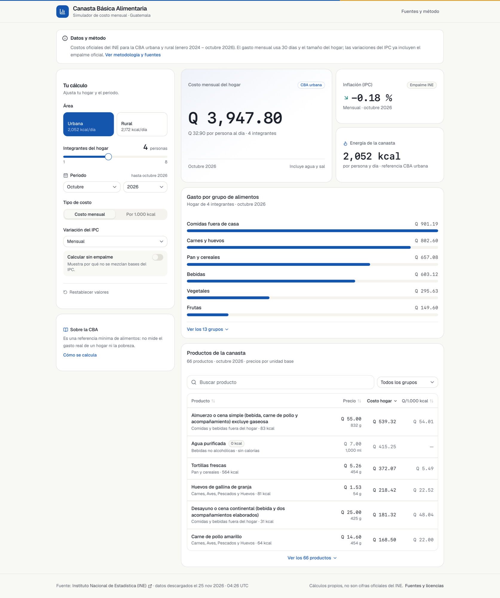
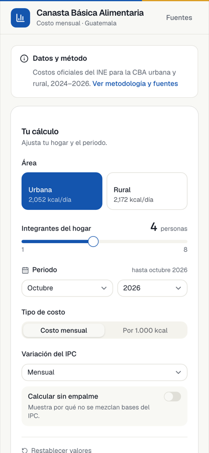
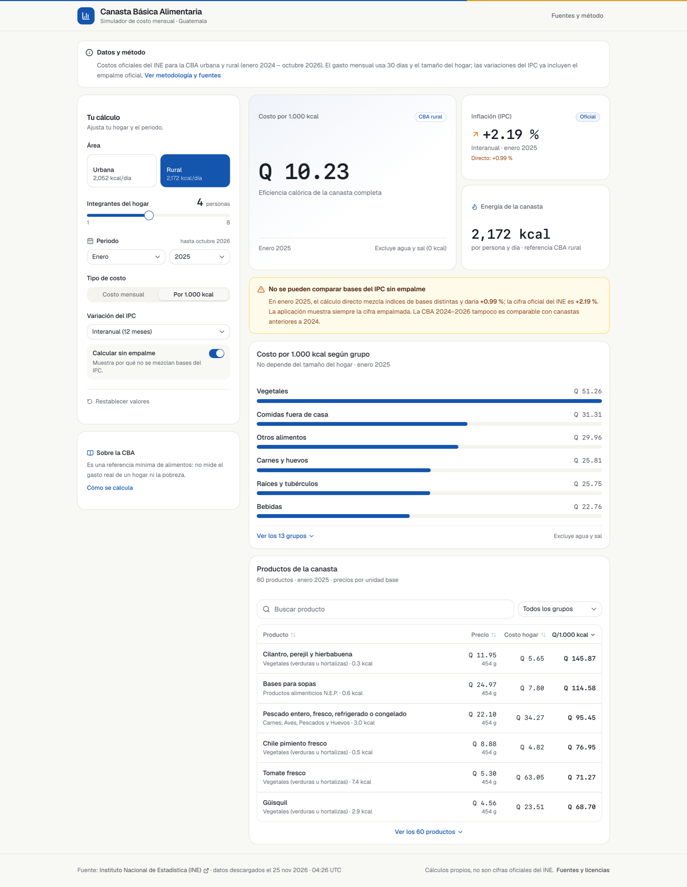
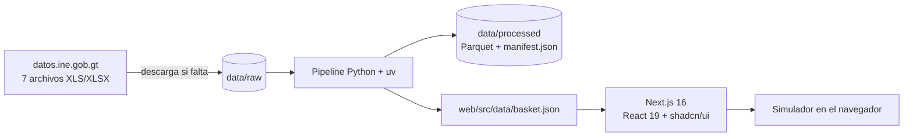

# Canasta Básica Alimentaria · Simulador de costo mensual

**Datatón INE 2026** · Categoría Tecnológica y Ciencias de Datos

Aplicación web local para estimar el costo mensual de la Canasta Básica
Alimentaria urbana y rural de Guatemala (enero 2024 – octubre 2026), comparar el
costo por cada 1.000 kcal y leer las variaciones del IPC con el **empalme
oficial del INE**. Sin servicios en la nube, sin claves de API y con procedencia
verificable de cada archivo.



<p align="center">
  
</p>

---

## 1. Problema y usuarios

El INE publica la CBA en hojas de cálculo separadas por área, con meses escritos
en español y con dos bases distintas del IPC (diciembre 2023 y 2024). Esa
estructura es correcta para especialistas, pero difícil de usar para el público:
un hogar no puede responder rápido «¿cuánto cuesta comer este mes?», y encadenar
los índices del IPC sin el empalme produce variaciones falsas.

La herramienta resuelve tres tareas concretas:

1. **Hogares y ciudadanía:** estimar el gasto mensual de la CBA para 1 a 8
   integrantes, en área urbana o rural, en cualquier mes publicado.
2. **Estudiantes, docentes y periodistas:** comparar el costo por 1.000 kcal
   entre alimentos y grupos, y entender por qué no se pueden mezclar bases del
   IPC sin el empalme oficial.
3. **Analistas:** auditar cada cifra contra la fuente del INE, con URL exacta,
   fecha UTC de descarga y hash SHA-256.

La CBA es una **canasta normativa** (un requerimiento mínimo de alimentos), no
el consumo observado de los hogares. El simulador no mide pobreza ni sustituye
las cifras oficiales del INE.

---

## 2. Qué hace la herramienta

- Panel de control con área (urbana/rural), tamaño del hogar (1–8), mes y año
  (enero 2024 – octubre 2026), y dos modos de análisis: **costo total** y
  **costo por 1.000 kcal**.
- Tarjetas de resumen con el costo mensual del hogar, la variación mensual o
  interanual del IPC —siempre con el empalme oficial— y la cobertura calórica
  diaria (2.052 kcal urbanas, 2.172 kcal rurales por persona).
- Desglose horizontal del gasto por grupo de alimentos, con los seis grupos
  principales a la vista y el resto a un clic.
- Tabla ordenable y filtrable de los 66 productos urbanos y 60 rurales (seis a
  la vista, con expansión), con precio por unidad base, kcal, costo del hogar y
  quetzales por 1.000 kcal.
- **Alerta metodológica** cuando se activa el cálculo directo del IPC y el
  periodo cruza el cambio de base (enero 2025): muestra la cifra oficial
  (+0,50 %) frente a la distorsionada (−0,67 %).
- Diálogo de **fuentes, metodología y licencias** con la procedencia completa.

---

## 3. Datos y rigor

### 3.1 Fuentes oficiales

Los siete archivos se obtienen del catálogo CKAN del INE
(`datos.ine.gob.gt`). La ingestión usa primero la copia local y sólo descarga si
falta el archivo; cada descarga queda registrada con URL, fecha UTC y SHA-256 en
`data/raw/download-registry.json` y en `data/processed/manifest.json`.

| Archivo | Contenido | Descarga UTC | Licencia CKAN |
| --- | --- | --- | --- |
| [`costo-cba-percapita_u.xlsx`](https://datos.ine.gob.gt/dataset/0317e7b9-9563-4a9c-800f-c74473103063/resource/6721d034-7af0-4622-ae34-be10f0f2ac89/download/costo-cba-percapita_u.xlsx) | Costo diario y mensual per cápita, CBA urbana | 2026-11-25 04:26:21 | No declarada (© INE) |
| [`costo-cba-percapita_r.xlsx`](https://datos.ine.gob.gt/dataset/0317e7b9-9563-4a9c-800f-c74473103063/resource/69abf503-56da-4de5-9017-875009394843/download/costo-cba-percapita_r.xlsx) | Costo diario y mensual per cápita, CBA rural | 2026-11-25 04:26:22 | No declarada (© INE) |
| [`historico-cbau_es_2024-2026.xlsx`](https://datos.ine.gob.gt/dataset/0317e7b9-9563-4a9c-800f-c74473103063/resource/595747ff-a866-4192-99fa-fc032a7795b7/download/historico-cbau_es_2024-2026.xlsx) | Grupos y productos de la CBA urbana | 2026-11-25 04:26:22 | No declarada (© INE) |
| [`historico-cbar_es_2024-2026.xlsx`](https://datos.ine.gob.gt/dataset/0317e7b9-9563-4a9c-800f-c74473103063/resource/23cf94ba-25e9-457b-87fd-a5c7c1e92bcd/download/historico-cbar_es_2024-2026.xlsx) | Grupos y productos de la CBA rural | 2026-11-25 04:26:23 | No declarada (© INE) |
| [`ipc_2024_datosabiertos.xls`](https://datos.ine.gob.gt/dataset/cfd35c49-2f16-4c85-b74c-d5f43659b7e1/resource/f9878de2-0d4d-4325-95f0-110567303db7/download/ipc_2024_datosabiertos.xls) | IPC por producto 2024, base dic-2023 = 100 | 2026-11-25 04:26:25 | CC BY 4.0 |
| [`base-de-datos-ipc-ano-2025_es.xls`](https://datos.ine.gob.gt/dataset/4243818d-b479-4bc1-aae6-2735e2b51265/resource/4b1c485c-78cb-4a0e-b11e-39306a8647f1/download/base-de-datos-ipc-ano-2025_es.xls) | IPC por producto 2025–2026, base 2024 = 100 | 2026-11-25 04:26:26 | CC BY 4.0 |
| [`ipc_emprepu_es25.xlsx`](https://datos.ine.gob.gt/dataset/4243818d-b479-4bc1-aae6-2735e2b51265/resource/6b2cb40a-188c-47c9-9288-ba11c40b5910/download/ipc_emprepu_es25.xlsx) | Empalme del IPC por República (variaciones oficiales) | 2026-11-25 04:26:28 | CC BY 4.0 |

Los SHA-256 completos están en el manifiesto y visibles en la aplicación
(*Fuentes y método*). Los archivos del IPC declaran **Creative Commons
Atribución (CC BY 4.0)**; el conjunto de costos de la CBA **no declara licencia
en CKAN**, por lo que se usa con atribución al INE y se advierte esa condición
en la interfaz y en este README.

### 3.2 Reglas de cálculo

| Regla | Implementación |
| --- | --- |
| Costo mensual per cápita | `costo diario × 30` |
| Costo del hogar | `costo mensual per cápita × integrantes` (1 a 8) |
| Costo por 1.000 kcal | `Σ costo de alimentos con kcal > 0 ÷ Σ kcal × 1.000` |
| Orden de meses | por `(año, número de mes)`; nunca alfabético |
| Variación del IPC | serie empalmada oficial, mensual e interanual |
| Cobertura calórica | 2.052 kcal/día urbanas y 2.172 kcal/día rurales por persona |

El agua purificada y la sal tienen **0 kcal** pero un costo relevante (el agua
rural puede superar el 4 % del gasto diario). En el modo por 1.000 kcal se
excluyen de ambos lados de la fracción: sumar su costo a la energía de otros
alimentos inflaría el indicador. La tabla las muestra marcadas con `0 kcal` y
`no aplica`.

### 3.3 El empalme del IPC, en una línea

El INE cambió la base del IPC en enero de 2025. Con los archivos crudos:

```text
2025-01 (base 2024)   101,017579
2024-12 (base dic-23) 101,702855
cociente directo:     −0,6738 %   ← inválido
```

Aplicando el factor de enlace oficial (`0,988306`):

```text
101,702855 × 0,988306 = 100,513541
101,017579 ÷ 100,513541 − 1 = +0,5015 %   ← oficial
```

La aplicación usa siempre la segunda cifra y conserva la primera sólo como
demostración didáctica, con una alerta visible. La diferencia se repite en todas
las variaciones interanuales de 2025 (por ejemplo, junio 2025: +0,59 % directo
frente a +1,79 % oficial).



### 3.4 Quiebre metodológico de la canasta

La CBA 2024–2026 usa la actualización metodológica del INE basada en la ENCOVI
2023. Sus productos, cantidades y requerimientos calóricos no son comparables
con las canastas anteriores a 2024. El simulador sólo expone enero 2024 a
octubre 2026 y no permite construir series que crucen ese quiebre; la advertencia
aparece en el aviso metodológico y en el diálogo de fuentes.

### 3.5 Validaciones automáticas

La ingesta falla de forma explícita si:

- falta un archivo y no hay conexión;
- un mes no se reconoce o hay periodos duplicados;
- los periodos de costos, productos y grupos no coinciden;
- la suma de kcal por grupo no cierra contra la hoja de grupos del INE;
- los productos no suman el costo per cápita publicado (tolerancia Q0,25/día);
- las kcal no son 2.052 (urbana) o 2.172 (rural);
- el empalme no reproduce +0,50 % en enero 2025 o −0,67 % en el cálculo directo;
- una descarga devuelve HTML o un archivo con firma incorrecta.

También se mide la brecha entre la hoja oficial de grupos y la suma de productos
(máximo Q0,063 por persona y día) y se reporta en el manifiesto.

---

## 4. Arquitectura



- **Ingesta (`pipeline/`)** — Python 3.11+ gestionado con **uv**. Valida el
  catálogo, descarga con respaldo local, normaliza meses, reconstruye la
  agrupación de productos, aplica el empalme y exporta Parquet + manifiesto y un
  artefacto JSON para la web.
- **Frontend (`web/`)** — **Next.js 16** (App Router, TypeScript, Tailwind CSS 4)
  con componentes **shadcn/ui**. La página es estática: importa el JSON generado
  por la ingesta, sin llamadas externas en tiempo de ejecución.
- **Datos** — `data/raw/` conserva las fuentes oficiales; `data/processed/`
  contiene las tablas limpias; `web/src/data/basket.json` es el artefacto que
  consume la interfaz.

### Estructura del repositorio

```text
.
├── data/
│   ├── raw/                     # 7 archivos del INE + registro de descargas
│   └── processed/               # Parquet + manifest.json
├── pipeline/
│   ├── pyproject.toml / uv.lock
│   ├── src/ine_basket/          # ingesta, reglas y pruebas
│   └── tests/                   # pytest
├── web/
│   ├── package.json / pnpm-lock.yaml
│   └── src/
│       ├── app/                 # layout, página, estilos
│       ├── components/          # UI shadcn + componentes del producto
│       ├── data/basket.json     # artefacto generado
│       └── lib/                 # tipos, formato y acceso a datos
├── docs/                        # capturas
└── README.md
```

### Modelo de datos

| Tabla | Filas | Contenido |
| --- | ---: | --- |
| `cba_monthly` | 68 | 34 meses × 2 áreas: costo diario/mensual per cápita, kcal, cobertura, Q/1.000 kcal, costo calórico y costo excluido (agua y sal) |
| `cba_products` | 4.284 | 34 meses × (66 urbanos + 60 rurales): producto, grupo, unidad base, precio, kcal, costo, Q/1.000 kcal, bandera 0 kcal |
| `cba_groups` | 884 | 34 meses × 2 áreas × 13 grupos: costo derivado y oficial, kcal, Q/1.000 kcal y brecha de redondeo |
| `ipc_monthly` | 34 | índices publicados por base, serie empalmada oficial, variaciones mensual/anual/acumulada, cálculo directo y banderas de cruce de base |

---

## 5. Instalación y ejecución local

### Requisitos

- Python **3.11+** y [uv](https://docs.astral.sh/uv/)
- Node.js **20+** y [pnpm](https://pnpm.io/) 10+
- Conexión a internet **sólo** la primera vez que falte un archivo; después todo
  funciona offline.

### 1. Ingesta de datos (uv)

```bash
cd pipeline
uv sync
uv run basket-ingest
```

El comando verifica los siete archivos en `data/raw`, descarga los faltantes,
escribe `data/processed/*.parquet`, `data/processed/manifest.json` y
`web/src/data/basket.json`. Para forzar una actualización:

```bash
uv run basket-ingest --refresh          # vuelve a descargar todo
uv run basket-ingest --offline          # falla si falta algo, nunca usa red
```

### 2. Aplicación web (pnpm)

```bash
cd web
pnpm install
pnpm dev          # http://localhost:3000
```

Para una compilación de producción:

```bash
pnpm build && pnpm start
```

### 3. Pruebas

```bash
cd pipeline
uv run pytest                 # 62 pruebas
uv run ruff check src tests   # estilo y errores estáticos
```

Las pruebas cubren: orden cronológico de meses en español, exclusión de
alimentos de 0 kcal, respaldo local/descarga y registro de procedencia,
variación oficial de enero 2025 (+0,50 %) frente al cálculo directo (−0,67 %),
escalado del hogar, reconstrucción de grupos, integridad del manifiesto y una
ejecución completa del pipeline sin red sobre una copia temporal.

### 4. Regenerar capturas o revisar la interfaz

```bash
cd web && pnpm lint && pnpm exec tsc --noEmit
```

---

## 6. Procedencia, licencias y atribución

**Datos:** Instituto Nacional de Estadística (INE), Guatemala. Cada archivo
conserva su URL exacta, fecha UTC de descarga, tamaño, SHA-256 y estado de
licencia en la aplicación (*Fuentes y método*) y en
`data/processed/manifest.json`.

- Serie del IPC: Creative Commons Atribución (CC BY 4.0).
- Costos de la CBA: **sin licencia declarada** en el catálogo CKAN; © INE. Uso
  con atribución, sin fines comerciales.
- Los cálculos, agrupaciones y visualizaciones son elaboración propia y **no
  constituyen cifras oficiales del INE**.

**Software de terceros** (licencias originales, sin modificaciones):

| Componente | Versión | Licencia |
| --- | --- | --- |
| Next.js / React / React DOM | 16.4.6 / 19.3 | MIT |
| Tailwind CSS | 4.3 | MIT |
| shadcn/ui, `cn`, Radix UI | 4.23 / 0.5 / 1.8 | MIT |
| Lucide React | 1.78 | ISC |
| Geist (tipografía) | — | SIL Open Font License 1.1 |
| pandas / NumPy | 3.1 / 2.5 | BSD-3-Clause |
| PyArrow | 26 | Apache-2.0 |
| python-calamine | 0.9 | MIT |
| requests | 2.34 | Apache-2.0 |
| pytest / Ruff | 9.2 / 0.17 | MIT |
| uv | 0.13 | MIT / Apache-2.0 |

El código de este repositorio se distribuye bajo la licencia MIT incluida en
`LICENSE`.

---

## 7. Declaración de uso de inteligencia artificial

Se utilizó **IA generativa** como asistente de programación y redacción:

- **Herramienta:** OpenCode (agente de código en terminal) con el modelo
  **DeepSeek V4.1 Flash**.
- **Uso:** redacción del pipeline, componentes de interfaz, pruebas y
  documentación; revisión de fórmulas y mensajes de la interfaz.
- **Control humano:** las decisiones de alcance, la verificación contra los
  archivos del INE y la validación de resultados se hicieron con las pruebas
  automáticas y revisión manual. El equipo puede explicar y defender el código.
- **Tiempo de ejecución:** la aplicación **no** usa modelos de IA ni servicios
  de terceros; sólo lee el JSON local generado por la ingesta.

---

## 8. Limitaciones y mejoras

**Limitaciones**

1. La CBA es una canasta normativa; no representa el consumo real ni mide
   pobreza, inseguridad alimentaria o inflación experimentada por un hogar.
2. El escalado por integrantes es lineal: no modela economías de escala,
   desperdicio, comidas fuera del hogar ni preferencias.
3. El costo mensual usa 30 días para todos los meses, por regla del PRD; un mes
   de 31 días costaría aproximadamente 3 % más.
4. Sólo hay dos áreas (urbana y rural). No se modelan diferencias regionales
   dentro de cada área, aunque el INE publica IPC por región.
5. La variación mostrada es la del **IPC general de la República**, no la de la
   división de alimentos y bebidas no alcohólicas.
6. La agrupación de cada producto se reconstruye a partir del orden y la suma de
   kcal de la hoja de productos; la hoja oficial de grupos difiere en menos de
   Q0,07 por persona y día por redondeo.
7. En noviembre de 2024 el archivo base 2023 y el empalme difieren 0,002 pp por
   una revisión del INE. La app usa el empalme, que es la fuente oficial vigente.
8. Los datos llegan a octubre 2026; noviembre y diciembre no estaban publicados
   al verificar (24–25 de noviembre de 2026).
9. El artefacto JSON es una fotografía estática: para actualizar hay que volver a
   ejecutar `uv run basket-ingest`.

**Mejoras posibles**

- Comparador de dos periodos con ajuste por IPC y cálculo de costo real.
- IPC por división de alimentos y por región, usando los archivos ya publicados
  por el INE.
- Canasta ampliada (CA) y cruce con salario mínimo y línea de pobreza.
- Exportación de resultados a CSV/PDF para docentes y periodistas.
- Pruebas de extremo a extremo del frontend y auditoría de accesibilidad WCAG AA.

---

## 9. Créditos

Proyecto desarrollado para el **Datatón INE 2026**. Datos: Instituto Nacional de
Estadística de Guatemala. Componentes de interfaz basados en shadcn/ui. El
historial de Git documenta la construcción durante el evento.

---

## English abstract

A local-first Next.js + shadcn/ui simulator for Guatemala's Urban and Rural Basic
Food Baskets (CBAU/CBAR, 2024–2026). A Python/uv pipeline downloads the official
INE spreadsheets when missing, records the exact URL, UTC timestamp and SHA-256,
normalizes Spanish month names chronologically, scales daily per-capita cost by
30 days and household size, and computes cost per 1,000 kcal while excluding
zero-calorie items such as salt and water. CPI variations come exclusively from
the INE's official splice across the December-2023 and 2024 base years; switching
to a direct calculation near the base break triggers an accessibility-friendly
alert that contrasts the official January 2025 variation (+0.50 %) with the
distorted unspliced figure (−0.67 %). All data, provenance and licenses are
visible in the UI and in `data/processed/manifest.json`.
