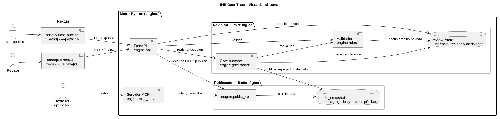
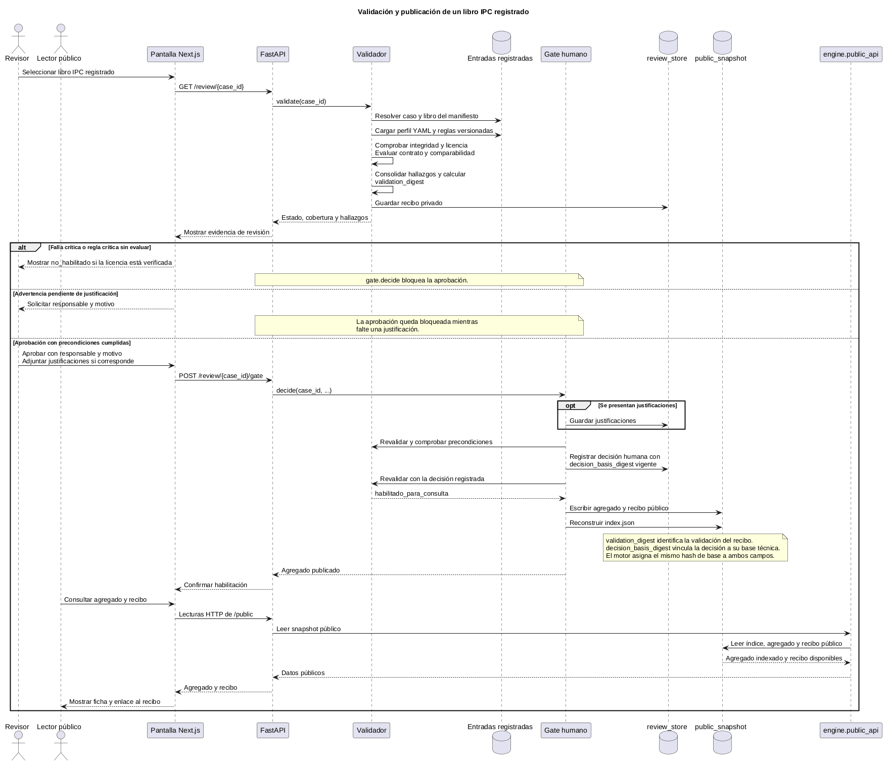
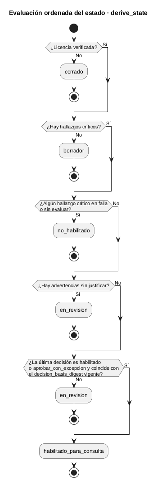
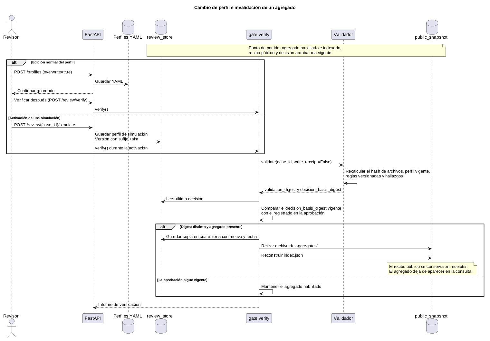

<div align="center">

# INE Data Trust

**Validación técnica y trazable de agregados estadísticos publicados.**

[](LICENSE)


</div>

INE Data Trust valida agregados estadísticos candidatos contra **contratos
declarativos en YAML**, detecta identidades incompatibles mediante SHA-256,
registra la decisión de un revisor humano y publica únicamente los agregados
habilitados junto con un **recibo reproducible**.

> **Aviso.** Este proyecto no implica certificación, aprobación ni adopción por
> el Instituto Nacional de Estadística (INE) de Guatemala. Fue desarrollado para
> el Datatón INE 2026, Categoría 2.

## Tabla de contenidos

- [Características](#características)
- [Inicio rápido](#inicio-rápido)
- [Arquitectura](#arquitectura)
- [Flujo de validación y publicación](#flujo-de-validación-y-publicación)
- [Modelo de estados](#modelo-de-estados)
- [Reglas de validación](#reglas-de-validación)
- [Contratos (perfiles YAML)](#contratos-perfiles-yaml)
- [Digest y reproducibilidad](#digest-y-reproducibilidad)
- [API HTTP del motor](#api-http-del-motor)
- [Servidor MCP](#servidor-mcp)
- [Interfaz web](#interfaz-web)
- [CLI](#cli)
- [Estructura del repositorio](#estructura-del-repositorio)
- [Pruebas](#pruebas)
- [Limitaciones](#limitaciones)
- [Documentación adicional](#documentación-adicional)
- [Licencias](#licencias)

## Características

- **Contratos declarativos.** Las columnas se resuelven por encabezado y los
  periodos por año y mes. Los contratos no declaran filas ni letras de columna;
  añadir uno no requiere modificar el código.
- **Resumen de variables y unidades.** Cada variable reporta tipo, unidad, base o
  alcance, nulabilidad, notas y conteos de valores válidos, nulos y excluidos.
  No calcula cocientes ni series.
- **Gate humano.** Ninguna publicación ocurre sin una decisión con responsable y
  motivo. Las advertencias requieren justificación documentada.
- **Invalidación automática.** Si cambian los datos, el contrato o las reglas, el
  digest deja de coincidir y el agregado se retira del corte público.
- **Recibos reproducibles.** El digest se calcula sobre datos, contrato, perfil,
  reglas y hallazgos; nunca sobre marcas de tiempo.
- **Separación de almacenes.** Revisión privada (`review_store`) y consulta
  pública (`public_snapshot`) están separados por diseño.
- **Determinista y sin red.** No hay modelos de IA, pagos ni servicios en la nube
  en tiempo de ejecución.
- **Servidor MCP de solo lectura** opcional sobre el corte público.

## Inicio rápido

### Requisitos

- [uv](https://docs.astral.sh/uv/) (Python ≥ 3.11)
- [pnpm](https://pnpm.io/) (Node.js)

No se usa `make`.

### Instalación y arranque

```bash
uv sync                       # entorno Python (uv.lock)
pnpm --dir web install        # interfaz Next.js
pnpm run prepare              # registra los recursos del snapshot (modo offline)
pnpm run dev                  # motor en :8000 + interfaz en el siguiente puerto libre
```

Abra la URL que imprime el arranque (por defecto <http://127.0.0.1:3000>). El
portal de consulta arranca **vacío**: un agregado solo aparece cuando un revisor
lo valida y registra su visto bueno en la bandeja de revisión.

La documentación interactiva de la API está en <http://127.0.0.1:8000/docs>.

### Scripts disponibles

| Script | Descripción |
|---|---|
| `pnpm run dev` | Arranca motor y web juntos (`scripts/dev.mjs`; Ctrl+C detiene ambos) |
| `pnpm run dev:engine` | Solo el motor (`uvicorn engine.api:app`, con `--reload`) |
| `pnpm run dev:web` | Solo la interfaz (`next dev`) |
| `pnpm run build:web` | Compilación de producción de la interfaz |
| `pnpm run prepare` | Registra recursos del snapshot y escribe `data/manifest.json` |
| `pnpm run verify` | Recalcula digests y retira agregados sin decisión vigente |
| `pnpm run profiles:check` | Valida los contratos YAML de `profiles/` |
| `pnpm run test` | Suite del motor y verificación de tipos |
| `pnpm run test:engine` | Solo `pytest` |
| `pnpm run test:web` | Solo `tsc --noEmit` |
| `pnpm run mcp` | Servidor MCP por stdio |
| `pnpm run licenses` | Regenera `docs/LICENSES_THIRD_PARTY.md` |

## Arquitectura

El sistema se compone de una interfaz Next.js, un motor Python con API HTTP y un
servidor MCP opcional. **El motor posee toda la lógica de validación y decisión;
la interfaz solo muestra y recoge datos.** El motor no importa código de `web/`.



| Componente | Ubicación | Responsabilidad |
|---|---|---|
| Interfaz web | `web/` | Next.js 15, React 19, Tailwind 4 y componentes shadcn/ui. Consume la API del motor; no valida ni decide. |
| API HTTP | `engine/api.py` | FastAPI. Expone `/review/*`, `/profiles/*` y `/public/*`. CORS limitado a `localhost:3000` y `127.0.0.1:3000`. |
| Validador | `engine/rules.py`, `engine/reader.py` | Lee CSV, XLSX y XLS heredado; evalúa las reglas; calcula digests; escribe el recibo privado. |
| Perfiles | `engine/profiles.py` | Carga y valida los contratos YAML con errores por campo. |
| Gate humano | `engine/gate.py` | Precondiciones, registro de decisiones, publicación, revocación y `verify()`. |
| Modelo de dominio | `engine/model.py` | `Finding`, `ValidationResult`, `derive_state()` y cobertura. |
| Serialización canónica | `engine/canonical.py` | JSON canónico y SHA-256. |
| Almacén de cargas | `engine/store.py` | Registro de archivos cargados por el revisor. |
| API pública | `engine/public_api.py` | Lectura exclusiva de `stores/public_snapshot/`. Compartida por HTTP y MCP. |
| Servidor MCP | `engine/mcp_server.py`, `mcp/server.py` | Dos herramientas de solo lectura. Sin LLM ni escritura. |
| CLI | `engine/cli.py` | Demuestra que motor y gate no dependen de la interfaz. |
| Preparación | `engine/prepare.py` | Descarga o registra recursos y escribe el manifiesto. |

### Límites lógicos

- **`stores/review_store/`** es privado: cargas, recibos privados, decisiones
  (`decisions.jsonl`), justificaciones, enmiendas de simulación y cuarentena.
- **`stores/public_snapshot/`** solo recibe agregados que superaron el gate:
  `aggregates/`, `receipts/` e `index.json`.
- **`engine.public_api`** solo abre archivos dentro de `public_snapshot/` y
  valida las rutas para impedir salidas del directorio. El servidor MCP depende
  exclusivamente de este módulo, por lo que no puede leer la cola de revisión.

## Flujo de validación y publicación



1. El revisor selecciona un recurso registrado o carga un archivo y elige un
   perfil y una licencia.
2. `rules.validate()` resuelve el caso, carga el perfil YAML y `rules/rules.json`,
   evalúa las reglas, consolida hallazgos, calcula el digest y guarda el recibo
   privado.
3. El revisor consulta estado, cobertura y hallazgos. Si hay advertencias,
   registra dueño y motivo de cada justificación.
4. `gate.decide()` revalida, comprueba precondiciones y añade la decisión
   (`operator`, `rationale`, `decision_basis_digest`) a `decisions.jsonl`.
5. El motor revalida con la decisión registrada. Si el estado resultante es
   `habilitado_para_consulta`, escribe el agregado y el recibo público y
   reconstruye `index.json`.
6. Los lectores consultan el corte público por HTTP (`/public/*`) o por MCP.

### Precondiciones del gate

`gate.decide()` rechaza la aprobación (`GateError`) cuando:

- el estado es `borrador` o `cerrado`;
- existe una regla crítica en `falla` o `no_evaluado`;
- hay advertencias sin justificación documentada;
- la licencia no está verificada (salvo en pares de identidad);
- la cobertura de reglas críticas no es completa.

El responsable es obligatorio y el motivo debe tener al menos 10 caracteres.
Las decisiones aceptadas son `aprobar`, `aprobar_con_excepcion` y `rechazar`;
`gate.revoke()` registra `revocado` y retira el agregado.

## Modelo de estados



`derive_state()` evalúa en orden estricto y devuelve el primer estado que aplique:

| # | Condición | Estado |
|---|---|---|
| 1 | Licencia no verificada | `cerrado` |
| 2 | Sin hallazgos críticos | `borrador` |
| 3 | Algún hallazgo crítico en `falla` o `no_evaluado` | `no_habilitado` |
| 4 | Advertencias sin justificar | `en_revision` |
| 5 | Sin decisión aprobatoria vigente para el digest actual | `en_revision` |
| 6 | Decisión aprobatoria (`habilitado` o `aprobar_con_excepcion`) que coincide con el digest | `habilitado_para_consulta` |

Severidades de hallazgo: `ok`, `falla`, `advertencia` y `no_evaluado`. No existe
el estado "aprobado por el INE" ni se asigna un puntaje.

## Reglas de validación

Las reglas están versionadas en [`rules/rules.json`](rules/rules.json)
(`rules_version` 1.1.0). Todas son críticas.

| ID | Alcance | Qué verifica |
|---|---|---|
| `SNAP-01` | agregado | El archivo coincide con los bytes y el SHA-256 del manifiesto |
| `LIC-01` | agregado | La licencia está verificada; sin ella el recurso se cierra por defecto |
| `CONT-01` | xlsx | La hoja observada es la declarada en el perfil |
| `CONT-02` | contrato | Cada columna declarada existe con su encabezado |
| `CONT-03` | contrato | Cada valor parsea al tipo del perfil |
| `CONT-04` | contrato | La combinación de columnas de grano no se repite |
| `CONT-05` | contrato | Los periodos declarados existen y no se mezclan |
| `CONT-06` | contrato | Resumen de variables, tipos, unidades, referencias y conteos |
| `ID-01` | par | Identidad por SHA-256: mismos bytes con identidad incompatible requieren revisión |

## Contratos (perfiles YAML)

Cada archivo `.yaml` de `profiles/` define un contrato. Ejemplo mínimo:

```yaml
profile_id: mi_contrato_v1
version: "1.0.0"
kind: xlsx                 # xlsx | delimited | pair
title: Mi contrato
expected_sheet: Hoja1
header_row: 1

schema:
  - { name: year, column: "Año", type: integer }
  - { name: month, column: "Mes", type: string }
  - name: value
    column: "Índice"
    type: float
    unit: índice
    reference: "2024=100"

types: [integer, float, string]
grain: [year, month]

dates:
  year: year
  month: month
  month_format: name_es    # name_es | number
  expected: ["2025-01", "2025-02"]

summary_notes: >
  Cobertura nacional; no se publican cifras derivadas.
```

Para validar contratos sin la interfaz:

```bash
uv run python -m engine.profiles                       # todos
uv run python -m engine.profiles profiles/mi_contrato.yaml
```

La referencia completa de campos está en [`profiles/README.md`](profiles/README.md).
La interfaz ofrece un formulario guiado ("Nueva regla") que genera el YAML y
devuelve errores por campo. Los contratos son **inmutables desde la interfaz**:
editar uno crea una copia con identificador nuevo.

## Digest y reproducibilidad



El `decision_basis_digest` es el SHA-256 del JSON canónico (claves ordenadas,
separadores fijos, UTF-8) de:

- los SHA-256 de los archivos evaluados;
- el perfil (id, versión y hash de contenido);
- las reglas (versión y hash de contenido);
- los hallazgos (`rule_id`, `status`, `critical`, evidencia).

**Las marcas de tiempo nunca entran en el digest.** Cada decisión guarda el
digest vigente al momento de aprobar. `gate.verify()` (`pnpm run verify` o
`POST /review/verify`) recalcula los digests; si difieren del registrado, el
agregado se copia a `quarantine/` con el motivo, se retira de `aggregates/` y se
reconstruye `index.json`. El recibo público se conserva.

Cada recibo separa `technical_payload` (reproducible) de `decision_log` (humano).

## API HTTP del motor

Base local: `http://127.0.0.1:8000`. Esquema interactivo en `/docs`.

| Método y ruta | Descripción |
|---|---|
| `GET /health` | Estado del servicio |
| `GET /profiles` · `GET /profiles/{id}` | Lista y consulta de contratos |
| `POST /profiles/validate` | Valida un YAML sin guardarlo |
| `POST /profiles` | Guarda un contrato (con `overwrite` opcional) |
| `GET /review/cases` | Bandeja de revisión |
| `GET /review/{id}` | Detalle: estado, cobertura y hallazgos |
| `POST /review/{id}/gate` | Registra una decisión humana |
| `POST /review/{id}/simulate` · `.../simulate/undo` | Activa o deshace una enmienda de simulación |
| `POST /review/upload` | Carga un archivo candidato |
| `POST /review/verify` | Recalcula digests e invalida agregados |
| `GET /review/{id}/receipt.json` | Recibo privado |
| `GET /public` · `GET /public/{id}` | Índice y ficha pública |
| `GET /public/{id}/receipt.json` | Recibo público |
| `GET /public/{id}/warnings` | Advertencias del agregado |

## Servidor MCP

Componente opcional, de **solo lectura** sobre `stores/public_snapshot/`. Sin LLM,
sin escritura y sin acceso a la cola de revisión. Transporte: stdio.

| Herramienta | Devuelve |
|---|---|
| `list_enabled_aggregates()` | Agregados con fuente, URL, fecha de descarga UTC, licencia, base, resumen de variables y `decision_basis_digest` |
| `get_aggregate_receipt(case_id)` | Metadatos, resumen de variables y unidades, y recibo público; o un bloqueo estructurado (`status: "bloqueada"`) si no está publicado |

```bash
pnpm run mcp
```

Configuración de ejemplo para un cliente MCP:

```json
{
  "mcpServers": {
    "ine-data-trust": {
      "command": "/ruta/a/ine-dataton/.venv/bin/python",
      "args": ["/ruta/a/ine-dataton/mcp/server.py"],
      "cwd": "/ruta/a/ine-dataton"
    }
  }
}
```

## Interfaz web

| Ruta | Función |
|---|---|
| `/` | Portal de consulta de agregados habilitados |
| `/review` | Bandeja: carga con arrastrar y soltar (`.csv`, `.xlsx`, `.xls`), selección de perfil y licencia, creación de perfiles |
| `/review/[id]` | Detalle, resumen de variables y unidades, hallazgos filtrables por severidad y formulario del gate |
| `/a/[id]` | Ficha pública: fuente, base, periodo, reglas evaluadas y descarga de `recibo.json` |
| `/a/[id]/ficha` | Ficha técnica imprimible para adjuntar al procedimiento 18 |

La interfaz implementa la *Guía de diseño gráfico para Datatón* del INE
(tipografía Ubuntu Sans servida localmente, paleta institucional y logotipos
oficiales en `web/public/`).

## CLI

El motor es utilizable sin interfaz:

```bash
uv run python -m engine.cli list                      # bandeja con estados
uv run python -m engine.cli validate [ids...]         # evalúa uno o todos
uv run python -m engine.cli promote <id> --operator "Nombre" --rationale "Motivo"
uv run python -m engine.cli revoke  <id> --operator "Nombre" --rationale "Motivo"
uv run python -m engine.cli verify                    # recalcula digests
uv run python -m engine.cli export  <id> --out salida.json
```

## Estructura del repositorio

```text
web/                  Next.js + TypeScript + Tailwind + shadcn/ui
engine/               Núcleo determinista en Python (uv)
mcp/                  Lanzador del servidor MCP
profiles/             Contratos declarativos YAML
rules/                Registro de reglas versionadas
data/                 Manifiesto y fuentes del snapshot
stores/
  review_store/       Cola privada: cargas, recibos, decisiones
  public_snapshot/    Agregados habilitados y recibos públicos
tests/                pytest (motor, API, MCP) con datos sintéticos y reales
docs/                 Diagramas PlantUML, licencias de terceros, uso de IA
scripts/              Arranque conjunto de motor y web (Node)
```

Los artefactos de sesión (cargas, recibos, decisiones, perfiles generados e
índice público) están en `.gitignore` y no se versionan.

## Pruebas

```bash
pnpm run test
```

- **Motor (pytest):** contrato, `.xls` heredado, identidad, resumen de variables
  y unidades, determinismo e invalidación del digest, gate, frontera de la API
  pública, aislamiento del MCP (incluida prueba por stdio) y directorios de
  ejecución.
- **API HTTP:** recursos registrados, carga, gate, invalidación por cambio de
  contrato, recibos y creación de perfiles con errores de campo.
- **Web:** `tsc --noEmit` sobre la interfaz.

La suite incluye dos recursos reales del conjunto CKAN *IPC Base Anual 2024=100*
(licencia `cc-by`) en `tests/data/real/`, con sus contratos en `tests/profiles/`.
Estos recursos no se publican en la aplicación.

## Limitaciones

- No hay piloto en sombra ni prueba de usabilidad ejecutada.
- La habilitación corresponde a este sistema, no al INE. No hay firma
  criptográfica ni autenticación.
- El hash prueba igualdad de bytes, no autoría ni calidad de los datos.
- La cobertura es la del perfil declarado, no la de toda la hoja.
- No se calculan variaciones, cocientes ni comparaciones entre periodos o series.
- `n<5` no se usa como garantía legal; no se afirma secreto estadístico.

## Documentación adicional

- [`docs/README.md`](docs/README.md): documento extendido del producto (problema,
  usuarios, recursos de prueba e identidad visual).
- [`PRD_INE_DATA_TRUST.md`](PRD_INE_DATA_TRUST.md): requisitos del producto.
- [`Nota Conceptual Datatón INE 2026.md`](<Nota Conceptual Datatón INE 2026.md>):
  nota conceptual.
- [`profiles/README.md`](profiles/README.md): referencia de contratos.
- [`docs/AI_USAGE.md`](docs/AI_USAGE.md): uso de IA en el desarrollo (el producto
  no incluye IA).
- Diagramas fuente en `docs/*.puml`.

## Licencias

- **Código:** MIT ([`LICENSE`](LICENSE)). No cubre los datos.
- **Datos del INE:** `cc-by`, atribuidos al Instituto Nacional de Estadística
  (INE), Guatemala.
- **Dependencias de terceros:** [`docs/LICENSES_THIRD_PARTY.md`](docs/LICENSES_THIRD_PARTY.md).
